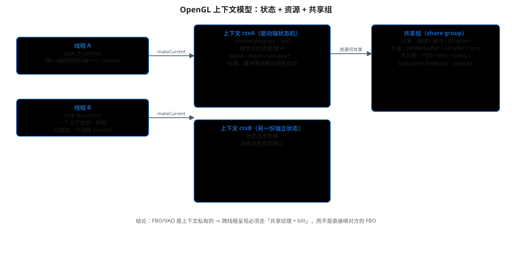
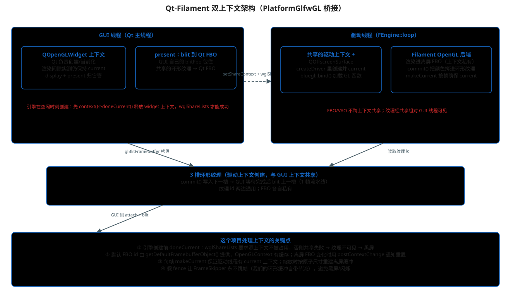

# OpenGL 上下文：概念、Qt 侧管理、Filament 侧管理与 PlatformGlfwGL 桥接

> 主文档：[README.md](./README.md)
>
> 本文回答三个问题：
> 1. OpenGL 上下文（Context）到底是什么、有什么规则；
> 2. Qt（QOpenGLWidget / QOpenGLContext）和 Filament（多线程后端）各自怎么管理上下文；
> 3. 本项目的 `PlatformGlfwGL` 如何把两者桥接起来——以及我们踩过的坑。



## 1. OpenGL 上下文：状态机 + 资源命名空间

### 1.1 上下文是什么

一个 OpenGL 上下文（Context）可以理解为**驱动侧的一份完整状态**：

- **当前状态**：current program、绑定的 VAO、绑定中的纹理/缓冲、混合/深度/面剔除开关、
  viewport、clear color……所有 `gl*` 调用读写的就是这份状态；
- **对象命名空间**：`glGenTextures/glCreateProgram/glGenBuffers` 创建的纹理、缓冲、
  program 等对象，都属于"创建它的那个上下文"；
- **线程绑定**：一个上下文在某一线程上 `makeCurrent` 之后，该线程的 GL 调用才有效。

关键规则：

```text
同一线程：同一时刻只能有一个 current 上下文（current context per thread）
同一上下文：同一时刻只能在一个线程上 current（WGL 强约束）
没有 current 上下文的线程调用 gl* → 未定义行为/崩溃
```

### 1.2 共享组（share group）

通过 `wglShareLists` / `QOpenGLContext::setShareContext` 可以把两个上下文放进
**同一共享组**。共享是有选择性的：

| 跨上下文共享 | 不共享（上下文私有） |
|---|---|
| 纹理对象 | Framebuffer（FBO） |
| 缓冲对象 | Vertex Array（VAO） |
| Program / Shader | Query 对象 |
| Renderbuffer / Sampler | Transform feedback / Pipeline |
| Sync 对象 | |

**这条表决定了本项目的呈现架构**：Filament 在驱动线程渲染，结果要显示到 Qt 窗口。
FBO 不共享，所以不能把驱动线程的 FBO 拿给 GUI 线程直接绑；正确做法是
**通过共享的纹理对象 + `glBlitFramebuffer` 拷贝**（见第 4 节）。

### 1.3 Windows 上的特殊性

- `wglShareLists(hglrc1, hglrc2)`：建立共享时要求**两个上下文都不处于 current 状态**，
  否则返回 `ERROR_BUSY`；
- `wglCreateContextAttribsARB` 创建带共享的上下文时，若属性与源上下文不匹配
  也可能失败；
- 这些是 Qt 内部去处理的，但**时机不对就会静默失败**——本项目黑屏问题的根源。

## 2. Qt 侧：QOpenGLWidget 与 QOpenGLContext

### 2.1 QOpenGLWidget 的上下文生命周期

`QOpenGLWidget` 内部自己持有一个 `QOpenGLContext`：

- 首次需要渲染时创建（与窗口绑定）；
- `initializeGL()` / `paintGL()` 执行期间该上下文是 **current** 的；
- Qt 文档说渲染间隙会释放，但本项目实测（Qt 5.15 + 连续 `update()` 渲染）：
  **在两次渲染之间上下文仍然保持 current**——这正是 `wglShareLists` 报
  `ERROR_BUSY` 的原因；
- 对外暴露 `context()` 拿到上下文指针、`defaultFramebufferObject()` 拿到 Qt 的 FBO id。

### 2.2 QOpenGLContext 的线程规则

Qt 允许一个 `QOpenGLContext` 在**任意线程** `makeCurrent`，只要：

- 它当前不在别的线程上 current；
- 关联的 QSurface（如 `QOffscreenSurface`）也被该线程使用；
- 尽量在创建它的线程上使用（跨线程需要 `moveToThread` 或对象本身创建于目标线程）。

`QOpenGLContext::currentContext()` 返回**当前线程**的 current 上下文；
`doneCurrent()` 把上下文从当前线程释放。

### 2.3 QOffscreenSurface

不绑窗口的离屏 surface。驱动线程需要一个"可以 makeCurrent 的面"，就用它：

```cpp
QOffscreenSurface* off = new QOffscreenSurface();
off->setFormat(fmt);   // 必须与上下文格式一致
off->create();
ctx->makeCurrent(off);
```

> Windows 上在非 GUI 线程创建 QOffscreenSurface 会打一条
> "Expect failures" 警告，但实测可用。

## 3. Filament 侧：平台抽象与多线程后端

### 3.1 多线程后端：命令流 + 驱动线程

本项目构建去掉了 `FILAMENT_SINGLE_THREADED` 后（见
[05-command-stream.md](./05-command-stream.md)），Filament 分两个线程：

```text
GUI 线程（frontend）：场景解析、生成命令 → 写入环形命令缓冲
驱动线程（FEngine::loop）：取出命令执行 → OpenGLDriver 的 GL 调用
```

引擎创建时（`filament/filament/src/details/Engine.cpp`）：

```text
FEngine::create
  └─ 启动驱动线程 std::thread(FEngine::loop)
        └─ FEngine::loop 内：
             mPlatform = PlatformFactory::create(...)      // 平台对象
             mDriver = mPlatform->createDriver(...)        // ← 驱动线程上调用
```

所以 **`PlatformGlfwGL::createDriver` 运行在驱动线程上**——这是本平台能在那里
创建 Qt 上下文的前提。

### 3.2 OpenGLPlatform 接口里和上下文相关的部分

`OpenGLPlatform`（`backend/platforms/OpenGLPlatform.h`）暴露给后端的钩子：

| 方法 | 后端何时调用 | 职责 |
|---|---|---|
| `createDriver` | 驱动线程初始化 | 建上下文、makeCurrent、加载 GL 函数（bluegl） |
| `makeCurrent(ContextType, draw, read)` | 旧接口 | 让上下文 current |
| `makeCurrent(draw, read, pre, post)` | 新版接口（默认转发旧接口） | 上下文切换；`post(index)` 通知后端 |
| `getDefaultFramebufferObject()` | 绑"默认 FBO"时 | 返回真正要渲染到的 FBO id |
| `commit(swapChain)` | 每帧末尾（驱动线程） | 呈现/交换 |
| `terminate()` | 引擎销毁 | 释放上下文 |
| `canCreateFence / createFence / waitFence` | 帧跳过后端、FrameInfo | 同步原语 |

### 3.3 默认 FBO 的解析与缓存（重要机制）

OpenGL 后端把"默认 framebuffer"当成一个 id 为 0 的 RenderTarget，真正绑定时的
解析发生在 `OpenGLContext::bindFramebuffer(GL_FRAMEBUFFER, 0)`：

```cpp
// filament/filament/backend/src/opengl/OpenGLContext.cpp
GLuint OpenGLContext::bindFramebuffer(GLenum target, GLuint buffer) noexcept {
    if (buffer == 0) {
        // 解析"默认 FBO"的真实名字，并缓存
        if (!mDefaultFbo[contextIndex].has_value()) {
            mDefaultFbo[contextIndex] = mPlatform.getDefaultFramebufferObject();
        }
        buffer = mDefaultFbo[contextIndex].value_or(0);
    }
    ...
}
```

缓存只在上下文切换时重置（`synchronizeStateAndCache` → `mDefaultFbo[index].reset()`）。
所以**如果平台返回的默认 FBO id 变了（如离屏缓冲重建），必须触发
`postContextChange(0)` 让后端清缓存**——这正是单线程版缩放黑屏的根源之一。

### 3.4 makeCurrent 的回调式接口

`OpenGLDriver::makeCurrent`（`OpenGLDriver.cpp`）调用平台：

```cpp
mPlatform.makeCurrent(scDraw->swapChain, scRead->swapChain,
        preContextChange,      // 切换前：解绑全部状态/流
        postContextChange);    // 切换后：postContextChange(0)，重置默认 FBO 缓存等
```

平台在真正发生上下文切换时才调用这两个回调。

## 4. 本项目 PlatformGlfwGL：Qt 与 Filament 的桥



### 4.1 为什么需要两个上下文

- Qt 的显示上下文（widget 的 context）属于 GUI 线程，负责最终呈现；
- Filament 后端要在**驱动线程**上执行 GL 命令，必须有 current 上下文；
- 一个 GL 上下文同一时刻只能在一个线程 current，Qt 的 widget 上下文不能
  让给驱动线程用；
- 于是：**驱动线程创建第二个上下文，与 widget 上下文共享纹理**，Filament
  渲染到驱动线程自己的离屏 FBO，GUI 线程把共享纹理 blit 到 Qt FBO。

### 4.2 createDriver（驱动线程上执行）

```cpp
// test/PlatformGlfwGL.cpp
Driver* PlatformGlfwGL::createDriver(...) noexcept {
    mDriverContext = new QOpenGLContext();
    QSurfaceFormat fmt = mSharedContext->format();  // 与 widget 完全一致
    fmt.setSamples(0);
    mDriverContext->setFormat(fmt);
    mDriverContext->setShareContext(mSharedContext);  // ← 共享纹理的关键
    mDriverContext->create();

    mOffscreen = new QOffscreenSurface(); ...
    mDriverContext->makeCurrent(mOffscreen);          // 驱动线程 current
    mGl = mDriverContext->versionFunctions<QOpenGLFunctions_4_5_Core>(); ...

    bluegl::bind();                                   // 加载 Filament 的 GL 入口
    recreateFramebuffers(w, h);                       // 先建一次离屏 FBO
    return OpenGLPlatform::createDefaultDriver(...);
}
```

要点：

- 上下文**创建并 current 在驱动线程**（因为 createDriver 就在驱动线程执行）；
- 格式与 widget 实际格式一致，最大化 `wglShareLists` 成功率；
- `mSharedContext` 是 GUI 线程在引擎创建前通过
  `platform->setSharedContext(context())` 传进来的 widget 上下文指针。

### 4.3 makeCurrent（每帧在驱动线程被调用）

```cpp
void PlatformGlfwGL::makeCurrent(draw, read, pre, post) {
    if (!mDriverContext->isCurrent()) {
        mDriverContext->makeCurrent(mOffscreen);     // 保证驱动线程 current
    }
    // 尺寸变化（GUI 线程写入原子变量）→ 重建离屏缓冲
    if (尺寸变化) recreateFramebuffers(w, h);
    // 离屏 FBO id 变了 → 通知后端重置默认 FBO 缓存
    if (mOffscreenFbo != mLastReportedFbo) {
        mLastReportedFbo = mOffscreenFbo;
        postContextChange(0);
    }
}
```

这里没有真正的"上下文切换"（驱动线程一直用自己的上下文），但**必须做两件事**：

1. 保证驱动线程有 current 上下文；
2. FBO 重建后 `postContextChange(0)`，否则后端还绑着旧 id（见 3.3）。

### 4.4 getDefaultFramebufferObject 与离屏 FBO

```cpp
uint32_t PlatformGlfwGL::getDefaultFramebufferObject() noexcept {
    return mOffscreenFbo;   // Filament 的"默认 framebuffer"= 我们的离屏 FBO
}
```

离屏 FBO 包含：一张 RGBA8 颜色纹理 + 一个深度 renderbuffer，尺寸跟随窗口。
Filament 的所有 pass（含后处理）最终都画进它。

### 4.5 commit：渲染结果进入共享纹理

```cpp
void PlatformGlfwGL::commit(...) noexcept {
    const uint32_t slot = mDriverSlot % RING_COUNT;      // 3 槽环形
    // 离屏 FBO → 环形纹理（同上下文内 blit，FBO 私有没问题）
    glBlitFramebuffer(0,0,w,h, 0,0,w,h, COLOR, NEAREST);
    mDriverSlot++;
    { lock; mCompletedFrames++; }                         // 通知 GUI
    mCond.notify_all();
}
```

环形纹理是在驱动上下文里创建的，**因为共享组，GUI 线程也能用它们的 id**。

### 4.6 GUI 线程呈现（debugOpenGlWidget.cpp 的 paintGL）

```cpp
// GUI 线程：等驱动线程完成上一帧的 commit，再把共享纹理 blit 进 Qt FBO
platform->waitFrameCompleted(mSubmittedFrames - 1);
glBindFramebuffer(GL_READ_FRAMEBUFFER, mBlitFbo);        // GUI 自有的 FBO
glFramebufferTexture2D(..., 共享纹理, 0);                 // 包住共享纹理
glBindFramebuffer(GL_DRAW_FRAMEBUFFER, defaultFramebufferObject());  // Qt FBO
glBlitFramebuffer(0,0,w,h, 0,0,w,h, COLOR, LINEAR);
```

GUI 的 `mBlitFbo` 是 GUI 上下文私有的（FBO 不共享没关系，只在本线程用），
纹理对象则来自共享组。

## 5. 踩过的坑（都跟上下文有关）

### 5.1 黑屏：wglShareLists ERROR_BUSY

- 现象：多线程版画面全黑（FPS 很高但没内容）；
- 根因：Qt 的 widget 上下文在渲染间隙仍保持 current，而
  `wglShareLists` 要求源上下文不被占用 → 共享失败 → 驱动线程的纹理
  对 GUI 线程不可见 → blit 到无效纹理 → 黑屏；
- 修复：引擎创建**延迟到空闲时刻**，并在创建前
  `context()->doneCurrent()` 主动释放 widget 上下文；
- 验证：`[CHECK] center pixel = 207,172,197,255`（非黑）。

### 5.2 缩放黑屏：默认 FBO 缓存

- 现象（单线程版）缩放窗口后黑屏；
- 根因：`OpenGLContext` 缓存默认 FBO id，只在上下文切换时重置；
  Qt 缩放会重建 FBO（id 变化），Filament 仍绑旧 id；
- 修复：`makeCurrent` 里比较 FBO id，变化时 `postContextChange(0)`
  触发后端清缓存（见 3.3）。

### 5.3 闪烁 / 全黑：帧跳过后端

- 现象：`DOMAINS_PER_MESH=5` 闪烁、`=1` 全黑；
- 根因：FrameSkipper 用 fence 判断 GPU 是否落后，落后时
  `beginFrame()` 返回 false，本帧没有渲染内容可呈现；
- 修复：平台提供**永远满足的假 fence**
  （`canCreateFence→true`、`waitFence→CONDITION_SATISFIED`），
  渲染循环自带环形缓冲节流；另加"跳帧时重复呈现上一帧"兜底。

## 6. 一帧的完整上下文活动（双线程）

```text
GUI 线程：
  ① Qt 使 widget 上下文 current → paintGL
  ② frontend：beginFrame/render/endFrame 入队（不执行 GL）
  ③ waitFrameCompleted(上一帧)         // 驱动线程完成上一帧 commit
  ④ 用自己的 FBO 包住共享纹理 → glBlitFramebuffer → Qt FBO
  ⑤ Qt 合成器把 widget FBO 呈现到屏幕

驱动线程：
  ⑥ makeCurrent(自己的上下文)          // 必要时重建离屏缓冲
  ⑦ 执行本帧命令：渲染进离屏 FBO
  ⑧ commit：离屏 FBO → 环形纹理槽，计数+1 并通知 GUI
  ⑨ 回到 ⑥ 处理下一帧
```

纹理经共享组互通，FBO/VAO 各自私有，互不干扰。

## 7. 源码位置

- 平台实现：`test/PlatformGlfwGL.h` / `test/PlatformGlfwGL.cpp`
- 引擎/线程：`filament/filament/src/details/Engine.cpp`（`FEngine::loop`、`createDriver`）
- 平台接口：`filament/filament/backend/include/backend/platforms/OpenGLPlatform.h`
- 驱动上下文：`filament/filament/backend/src/opengl/OpenGLDriver.cpp`（`makeCurrent`）
- 默认 FBO 解析：`filament/filament/backend/src/opengl/OpenGLContext.cpp`
- 帧跳过后端：`filament/filament/src/FrameSkipper.cpp`
